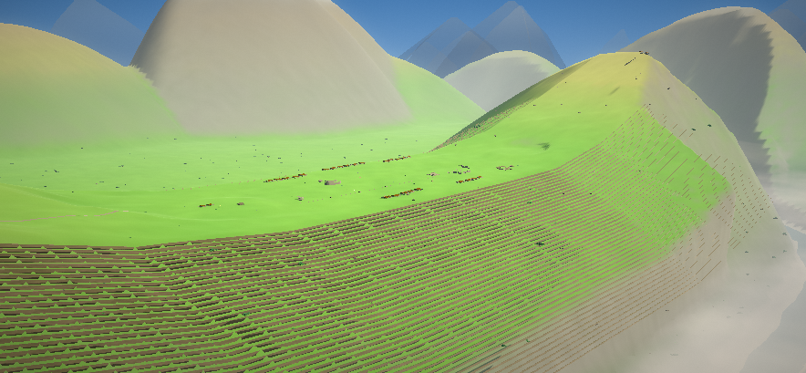

# Machu Picchu

**▶ Play: https://angie4448.github.io/machu-picchu/**

An open-world walk through the Inca citadel at 2 431 m — terraced flanks, the Urubamba
gorge 670 m below, a sea of cloud at dawn, and a paraglider to get you down there.



## What's in it

- **Real geography.** A 3 km analytic ridge: the citadel's saddle at 2 431 m,
  Huayna Picchu at 2 720 m, the Urubamba carving a 670 m gorge beneath it.
- **Terraces.** Constant-width treads with retaining walls generated from the same
  analytic profile as the terrain, so the two line up exactly.
- **Sky.** Eight time-of-day palettes, a sun and moon, stars and the Milky Way, six
  weather states including rolling valley mist.
- **Life.** 5 400 wind-swayed grass tufts, cloud forest, llamas that graze and look up
  at you, condors circling the peak.
- **Playing.** Walk, sprint, climb, glide, swim. Stamina, landmarks, a passport,
  collectible sun medallions, and a photo mode that saves to a local album.
- **Touch controls.** Plays in landscape on a phone.

## Tech

One self-contained HTML file. No build step, no network requests.

- three.js r149 (MIT), inlined
- Custom toon shader with hand-rolled shadow mapping
- Procedural textures generated on a canvas at load time
- All audio synthesised at runtime with WebAudio
- Post-processing: bloom, god rays, colour grading

## Run locally

Double-click `index.html`, or:

```bash
python -m http.server 8000
# open http://localhost:8000
```

## Licence

Code MIT. Three.js © its authors, MIT.
